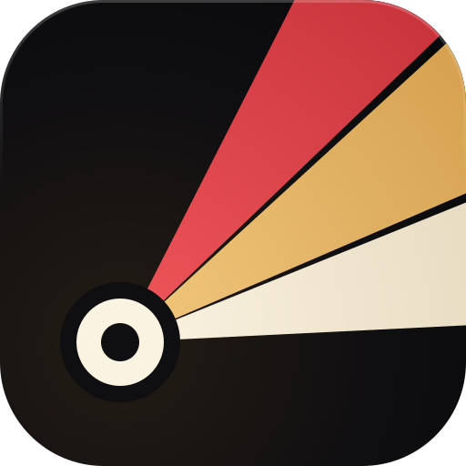

# Lanterninha

Um Letterboxd pessoal, pra ti e teus amigos. Responde perguntas rápidas sobre o que sentiu no filme e sai uma nota de ½ a 5 estrelas. Também guarda tua fila, mostra a nota dos amigos e tem um jogo de palpite.

Site: https://lanterninha.vercel.app

## Como rodar

```
npm install
npm run dev
```

Abre o endereço que aparecer no terminal. A busca de filmes usa as funções do site publicado, então funciona sem configurar nada.

## Comandos

| Comando | O que faz |
| --- | --- |
| `npm run dev` | Roda o app no computador, atualizando a cada mudança |
| `npm run build` | Confere os tipos e monta a versão final na pasta `dist` |
| `npm run preview` | Abre a versão final montada |
| `npm run android` | Monta e abre o projeto Android no Android Studio |

## Como o projeto está organizado

```
api/               Funções do servidor (Vercel): busca, detalhes do filme e pôster. Guardam a chave do TMDB.
public/            Ícones e o manifesto (o que deixa instalar como app no iPhone)
src/
  main.tsx         Ponto de partida
  App.tsx          A moldura: barra de cima, tela atual, abas
  nav.ts           Navegação: qual aba, qual tela aberta, o que está por cima
  native.ts        O que só existe no app Android (botão de voltar)
  lib/             Regras e dados, sem nada de tela
    films.ts         Lista de filmes guardada no aparelho
    cloud.ts         Conta, sincronização, amigos, indicações e palpite (Supabase)
    quiz.ts          As perguntas e a conta da nota
    api.ts           Conversa com as funções de /api
    share.ts         Imagem de compartilhar
    sfx.ts           Sons da avaliação
    color.ts         Cor do fundo a partir do pôster
    backup.ts        Exportar e importar
  components/      Peças pequenas usadas em várias telas (estrelas, pôster, avatar…)
  screens/         As telas: Avaliar, Início, Meus filmes, Perfil, Filme, Amigo, Perguntas, Resultado
  overlays/        Telas que abrem por cima: reviews, editor, compartilhar, editar perfil, indicar, palpite
  styles/app.css   Todo o visual
```

## Feito com

React, TypeScript e Vite. Supabase para contas e dados. Vercel para hospedar. Capacitor para virar app Android.

Este produto usa a API do TMDB, mas não é endossado nem certificado pelo TMDB. Disponibilidade em streaming: dados da JustWatch.
