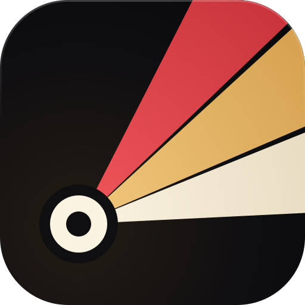

# Lanterninha

Antigamente o lanterninha te levava até o seu lugar no escuro do cinema. Hoje o app, com perguntas rápidas, te leva até a sua nota para os filmes!

Em vez de dar nota pra roteiro, direção e afins, você responde como foi a sua experiência com o filme. No final sai uma sugestão de ½ a 5 estrelas, que dá pra ajustar.

## O que tem

- Sete perguntas, cinco opções cada, uma por tela
- Modo clássico, pra separar a sua experiência da fama do filme
- Modo reassistir, que mostra a nota de antes e a de agora
- Comparação com um filme de nota parecida que você já avaliou
- Busca de filmes com título original, ano e pôster (via TMDB)
- Histórico salvo no próprio navegador (nada vai pra servidor)

## Como rodar

É um arquivo só. Abra o `index.html` no navegador.

## Feito com

HTML, CSS e JavaScript puro.

Este produto usa a API do TMDB, mas não é endossado nem certificado pelo TMDB.
